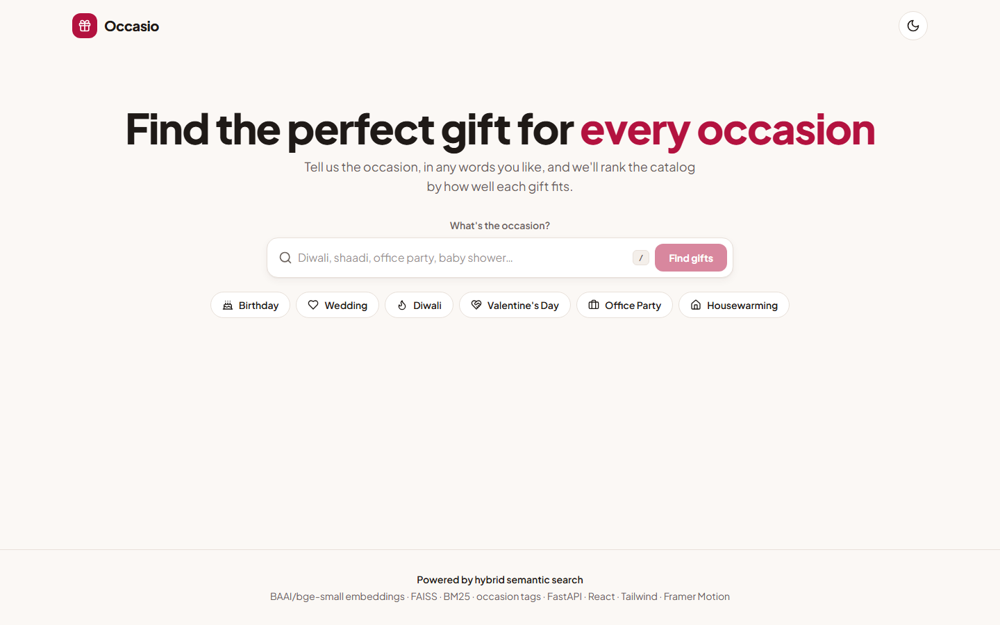
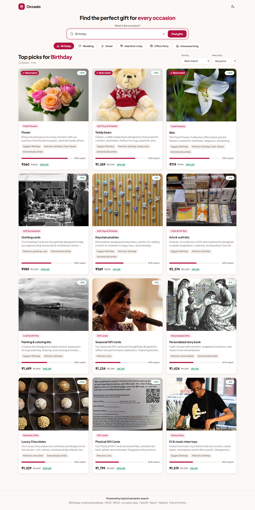
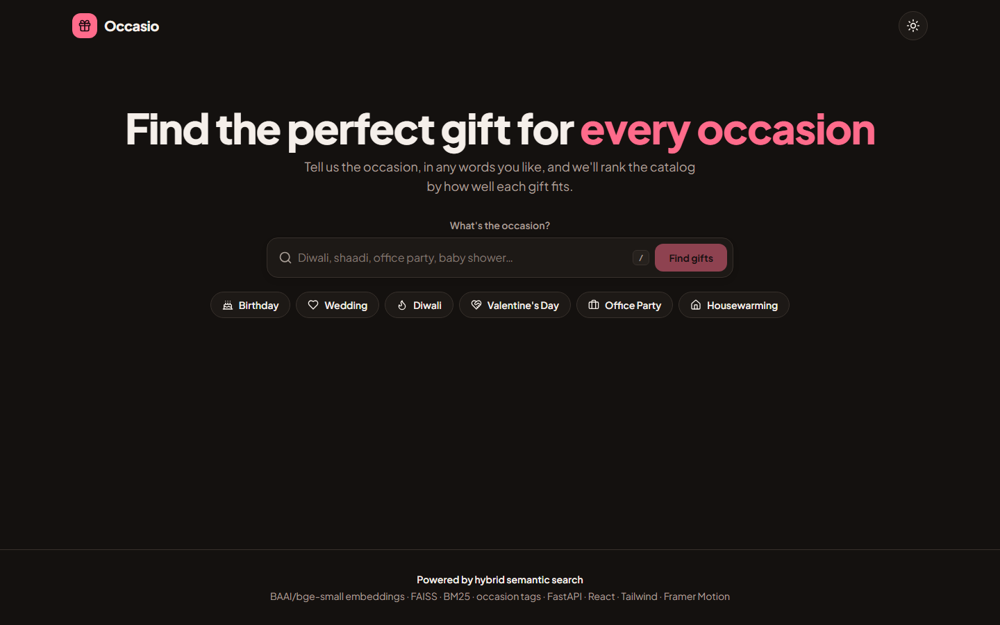
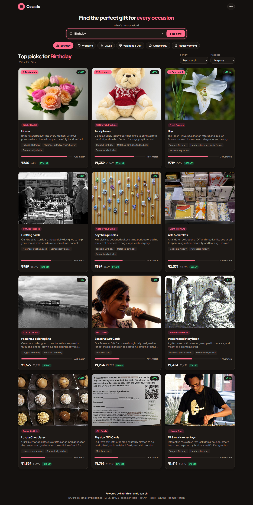

# Occasio – Occasion-Based Product Recommender

   

Type an occasion ("Diwali", "shaadi", "office party", "baby shower") and get a ranked grid of catalog
products on the same page. The engine is a **hybrid of semantic embeddings (FAISS), offline occasion tags and
BM25 keyword matching**. All expensive work runs once offline, so a query is answered in tens of milliseconds
with no LLM call.

| Input screen | Results screen |
|---|---|
|  |  |
|  |  |

More: [autocomplete](docs/screenshots/02-autocomplete-light.png) ·
[quick view with score breakdown](docs/screenshots/04-quickview-light.png) ·
[empty state](docs/screenshots/05-empty-light.png) · [mobile 375px](docs/screenshots/06-results-mobile.png)

> **Note on product images.** Every `mainImage` URL in the supplied `products.json` returned HTTP 404
> (`s3aws.emilo.in`), so each product now uses a real photo downloaded from Wikimedia Commons and stored in
> `frontend/public/product-images/` (see [Image credits](#image-credits)). The UI still falls back to a gift tile if an image fails.

## Tech stack (mapped to the brief's section 4)

| Brief says | What this project uses |
|---|---|
| Backend: Python (FastAPI / Flask / Django), *preferred* | **Python 3.11 + FastAPI**, Pydantic v2, Uvicorn |
| Frontend: React, Next.js or plain HTML/JS; any UI library | **React 18 + Vite + TypeScript**, **Tailwind CSS**, Framer Motion, lucide-react |
| HuggingFace Transformers / Sentence-Transformers | **sentence-transformers** with `BAAI/bge-small-en-v1.5` (CPU) |
| Qdrant / FAISS / Pinecone for vector search (optional) | **FAISS** `IndexFlatIP` (cosine on L2-normalised vectors) |
| OpenAI / Gemini API if preferred | Optional **Anthropic Claude** for offline tagging only (no key needed to run; see below) |
| Simple TF-IDF or keyword matching acceptable | **BM25** (`rank_bm25`) and **TF-IDF** (scikit-learn), both built and compared |

## Brief requirements checklist

| Requirement (brief §3 / §5) | Status |
|---|---|
| Labelled occasion input ("What's the occasion?") | Done: [`SearchBar.tsx`](frontend/src/components/SearchBar.tsx) |
| Visible action trigger | "Find gifts" button, plus Enter key and clickable chips |
| Ranked results below the input, same page | Done (no routing; the hero compacts upward on search) |
| Card shows title, category, description snippet, image | Done; local product photos, falls back to a tile if an image fails |
| Empty-state message | Done ([`EmptyState.tsx`](frontend/src/components/EmptyState.tsx)) |
| Responsive design (bonus) | 1 / 2 / 3 / 4 columns; checked visually at 1440 px and 375 px |
| Adapter reads the brief's payload fields | Done: `product_id/productId`, `vendor_id/vendorId`, `vendor_category`, `vendor_category_desc`, `title`, `description`, `files` **and** the catalog's own keys (tested) |
| Recommendation logic explained | See "Recommendation logic" below |
| README with setup, tech stack, API usage; libraries cited; AI usage stated | This file |
| Two UI screenshots | `docs/screenshots/01-input-*.png` and `03-results-*.png` |
| Public GitHub repo link | Done: this repository |

## Quick start

```bash
git clone https://github.com/suryakantsahu371/occasion-based-product-recommendation.git
cd occasion-based-product-recommendation
```

**Docker** (one command, no API key needed): `docker compose up --build` → open <http://localhost:8080>.
*(I wrote the Dockerfiles/compose file but did not run a Docker build in my environment, so treat them as untested.)*

**Manual** (what I ran and tested; Python 3.11, Node 20+):

```bash
make setup           # venv + backend deps + frontend deps
make run             # API on :8000 and UI on :5173  -> http://localhost:5173
make test            # 79 pytest tests
```

Without `make` (e.g. Windows PowerShell):

```powershell
cd backend; python -m venv .venv; .venv\Scripts\python -m pip install -r requirements-dev.txt
.venv\Scripts\python -m uvicorn app.main:app --port 8000        # terminal 1
cd ..\frontend; npm install; npm run dev                         # terminal 2
```

The enriched data and all indexes are **committed** (`backend/data/`), so nothing needs to be built before
running. The first start downloads `BAAI/bge-small-en-v1.5` (~130 MB) from Hugging Face. Rebuild after a catalog
change with `make index`. Use an LLM for the tags with `ANTHROPIC_API_KEY` set + `make enrich-llm` (see below).

## API

```bash
curl localhost:8000/health
curl localhost:8000/api/occasions
curl -X POST localhost:8000/api/recommend -H 'Content-Type: application/json' \
  -d '{"occasion": "Diwali", "top_k": 12, "max_price": 3000, "keyword_method": "bm25"}'
```

`POST /api/recommend` returns `query` (`raw`, `matched_occasion`, `matched_label`, `match_type`
= exact / fuzzy / open_ended), `results[]` (`product_id, title, category, description_snippet, description,
image, shop, price, final_price, discount_pct, score, breakdown{semantic,tag,keyword,name_boost,penalty}, reasons[]`),
`total`, `keyword_method` and `latency_ms`. Empty or >100-char occasions → HTTP 422; no match → HTTP 200 with
`results: []`. `max_price` filters on the discounted price and skips price-outlier products. Interactive docs:
`/docs`.

## Architecture

```
OFFLINE (make index)                              ONLINE (per query, in memory)
products.json ─► adapter + filter + quality ─┐    React UI ─► POST /api/recommend
                 category labels ────────────┤        │
                 occasion tags (LLM | rules) ┤    query.py: normalise → synonyms → rapidfuzz → expansion
                 search document ────────────┤        │
                 bge-small → FAISS IndexFlatIP ──►  retriever.py: cosine (FAISS) + BM25/TF-IDF + tags
                 BM25 + TF-IDF pickles ──────┘        │
                 enriched_products.json (committed)  ranker.py: score → threshold → MMR (≤2/group) → reasons
```

```
backend/app/{config,taxonomy,schemas,adapter,quality,tagger,enrichment,query,retriever,ranker,main}.py
backend/scripts/{audit,enrich,build_index,evaluate,generate_product_images}.py     backend/tests/     backend/data/
frontend/src/{api.ts, hooks/useRecommendations.ts, components/*}
```

### Recommendation logic and why hybrid

`score = 0.45·semantic + 0.35·tag + 0.20·keyword + name_boost(+0.3) − conflict_penalty(0.5) − quality_penalty`
(all weights live in [`config.py`](backend/app/config.py)).

* **semantic** – cosine between the *expanded* query ("Diwali" → "diwali festival gifts: dry fruit hampers,
  sweets, candles, diyas…") and the product's search document (`name | category | shop | description | strong
  occasion tags`), rescaled with fixed anchors (0.40 → 0, 0.80 → 1) so unrelated queries score ~0 instead of being
  stretched to fill the range.
* **tag** – offline occasion-fit score (0–1) for the matched occasion.
* **keyword** – min-max normalised BM25 (default) or TF-IDF cosine (`keyword_method`).
* **conflict penalty** – a product tied to a *different* festival (a Holi hamper on a Diwali search).
* **quality penalty** – junk/placeholder text, implausible price, near-empty description (down-weighted, never deleted).
* **open-ended queries** (no taxonomy match, e.g. "chocolate") redistribute the tag weight to semantic + keyword,
  and a result must show real evidence (cosine ≥ 0.62, or a keyword hit backed by cosine ≥ 0.52).

Each signal covers another's blind spot: keywords miss intent ("Forever Rose" never says "Valentine"),
embeddings confuse sibling festivals (Diwali vs Holi hampers look almost identical), and tags capture intent but
are frozen at index time. After scoring, results below 0.35 are dropped and **MMR (λ=0.85) with a hard cap of 2 per
`productGroupId`** picks the final list.

### Offline enrichment: LLM path vs. the rule-based fallback

`scripts/enrich.py` has two interchangeable backends writing the same file:

* `llm` – Claude with forced tool-use, temperature 0, Pydantic validation (tags outside the taxonomy are
  rejected), cached per product. **I could not run this path: I had no API key, so it is untested.**
* `rules` – deterministic keyword + vendor-identity rules in [`tagger.py`](backend/app/tagger.py). **This is what
  produced the committed `enriched_products.json`**, so the shipped tags are rule-based, not LLM-generated.
  Category labels ("Festive Hampers", "Fresh Flowers", …) come from keyword voting over each `categoryId` group.

`--method auto` (default) uses the LLM only if `ANTHROPIC_API_KEY` is set, so the app runs end to end with zero keys.

## Data audit (`python backend/scripts/audit.py`)

The catalog has **110 payloads, not ~100**; 104 are indexable.

| Finding | Handling |
|---|---|
| Keys differ from the brief (`id`, `shopId`, `categoryId`, `name`, `mainImage`; no `vendor_category_desc`) | `adapter.py` accepts both shapes; category descriptions inferred offline |
| 6 products DRAFT / REVIEW_REQUIRED / unapproved | excluded from the index (test asserts they never appear) |
| Placeholder / junk text (`gcdyuvdcbdjhbc`, "deepesh created", "…created by Deepesh…"), prices ₹1 and ₹100,000 | 8 live products flagged (`junk_text`, `placeholder_text`, `price_outlier`, `thin_description`) and down-weighted |
| `shortDescription` is a truncated copy or a shelf-wide blurb | kept only if it adds ≥3 new words, trimmed to the last full sentence; a blurb repeated on ≥3 products is dropped from the search text (it describes the shelf, not the product) |
| Two products both named "Flower" | de-duplicated by `productGroupId` (max 2 per group) |
| Shop name hidden in `slug` | extracted (`flower-bloom by the hour-t7duskal` → "bloom by the hour") and used as a tagging signal |
| String prices, mixed weight units, generic HSN codes | prices parsed to float; weight/HSN/GST/dimensions ignored for ranking (the committed `products.json` is the original file, unmodified) |

## Evaluation

`python backend/scripts/evaluate.py` scores five variants on `data/gold.json` (10 occasions × 5–8 relevant
products). All variants share query expansion and the same MMR/group-cap stage, so only the scoring signal
differs. Cells are Precision@5 / nDCG@10.

| Occasion | TF-IDF only | BM25 only | Semantic only | Hybrid (TF-IDF) | Hybrid (BM25) |
|---|---|---|---|---|---|
| Birthday | 0.60 / 0.61 | 0.80 / 0.81 | 0.60 / 0.63 | 0.80 / 0.90 | 0.80 / 0.90 |
| Kids birthday | 1.00 / 0.84 | 1.00 / 0.84 | 0.80 / 0.64 | 0.60 / 0.63 | 0.60 / 0.63 |
| Wedding | 0.40 / 0.43 | 0.40 / 0.43 | 0.20 / 0.25 | 0.60 / 0.76 | 0.60 / 0.75 |
| Valentine's Day | 0.60 / 0.69 | 1.00 / 0.75 | 0.60 / 0.58 | 0.80 / 0.73 | 0.80 / 0.74 |
| Diwali | 0.40 / 0.66 | 0.40 / 0.68 | 0.40 / 0.63 | 1.00 / 0.90 | 1.00 / 0.98 |
| Holi | 0.40 / 0.67 | 0.40 / 0.67 | 0.40 / 0.76 | 0.60 / 0.80 | 0.60 / 0.80 |
| Christmas | 0.60 / 0.81 | 0.60 / 0.81 | 0.40 / 0.60 | 0.60 / 0.64 | 0.60 / 0.64 |
| Housewarming | 0.60 / 0.70 | 0.60 / 0.71 | 0.80 / 0.73 | 1.00 / 0.83 | 1.00 / 0.83 |
| Baby shower | 0.40 / 0.55 | 0.40 / 0.55 | 0.60 / 0.84 | 0.80 / 0.87 | 0.80 / 0.87 |
| Office party | 0.80 / 0.72 | 0.80 / 0.72 | 0.80 / 0.73 | 0.80 / 0.58 | 0.80 / 0.58 |
| **Mean** | **0.580 / 0.666** | **0.640 / 0.696** | **0.560 / 0.638** | **0.760 / 0.764** | **0.760 / 0.771** |

**Conclusions.** Both hybrids beat every single-signal variant (+0.12 P@5 and +0.07 nDCG@10 over the best single
signal, BM25-only). Between the two hybrids the gap is within noise: they tie on P@5 (0.76) and BM25 leads nDCG@10 by
0.007. I chose **BM25 as the default** because nDCG@10 is the rank-aware metric and BM25 was the stronger keyword-only
baseline; either is one config flag away. The hybrids are not better everywhere: on Kids birthday they score lower
than keyword-only (P@5 0.60 vs 1.00), and on Office party they tie on P@5 but have lower nDCG@10 (0.58 vs 0.72). I
did not investigate the cause; the 2-per-group cap and the title name-boost (an *Office wears* shirt ranks first) are
the likely contributors. This is a real weakness, not hidden.

**Caveats you should weigh.** (1) The gold set was judged by me (the AI assistant) from product text, not by
independent human annotators. (2) With only 10 queries and ~104 products, differences of a few hundredths are noise.
(3) The tags and the gold labels both came from reading the same catalog, so the hybrid's advantage is probably
overstated. (4) Weights are the design's hand-set priors; **I did not tune them** on the gold set, to avoid fitting
a set this small.

## Tests

79 tests pass (`make test`, roughly 15-60 s depending on model load): the brief's acceptance checks (Diwali, Valentine's Day, Office party, Kids
birthday, Housewarming, Baby shower, "shaadi"/"diwaali" mapping, "xyzqwerty" → empty + HTTP 200, no unpublished
product ever returned), plus adapter (both payload shapes), junk detector, synonyms/typos, scorer and API tests
(TestClient). Two acceptance checks were interpreted slightly: "Office party" requires ≥4 of the top 5 to be
Gifftery (an *Office wears* shirt ranks high on its title), and "Housewarming" accepts any décor product (the
natural-fibre décor item can lose its slot to the 2-per-group cap, but *Recycled & Upcycled Gifts* is décor).

## Frontend

React 18 + Vite + TypeScript + Tailwind (tokens in `tailwind.config.js` / `index.css`) + Framer Motion +
lucide-react. Hero search ("What's the occasion?", `/` to focus, arrow-key autocomplete, clear button), quick chips,
results header with sort and max-price filter, cards with match bar and reason chips, quick-view modal with the
score breakdown, skeleton / empty / error states, dark mode (system default + toggle), `prefers-reduced-motion`
respected, in-flight requests cancelled via `AbortController`. `tsc`, ESLint and Prettier are clean.
**Not measured:** Lighthouse scores and a screen-reader pass; I only checked the layout visually at 1440 px and 375 px.

## Trade-offs and future work

* Tags are frozen at index time and the taxonomy is fixed; unlisted occasions ("retirement party") fall back to
  open-ended search and currently return an empty state rather than guessing.
* Out-of-catalog occasions like Raksha Bandhan return very little because the catalog has no such products.
* Only 16 occasions; the synonym table is hand-written (Hindi/Hinglish terms only).
* FAISS flat index is exact and fine at ~100 products; swap for HNSW/Qdrant at scale (isolated in `retriever.py`).
* Future: learn weights from click data, recipient/budget/delivery filters, CLIP image embeddings, seasonal boost,
  incremental indexing.

## Image credits

* **Source:** product photos come from [Wikimedia Commons](https://commons.wikimedia.org/) (search API, no key needed),
  fetched by `backend/scripts/generate_product_images.py`. Each product name is mapped to a search term
  (e.g. "Teddy bears" -> "teddy bear") and the first suitable JPEG (>= 600 px wide) not already used is saved as
  `frontend/public/product-images/<SKU>_<name>.jpg`; `data/products.json` `mainImage` is set to `/product-images/<file>`.
* **Licenses:** Commons files carry their own licenses (mostly CC BY / CC BY-SA / public domain) and per-image author
  attribution is not stored. They are used here for demo purposes only; check each file's license page on Commons
  before any commercial use.
* **Regenerate:** `cd backend && python scripts/generate_product_images.py`, then re-run `scripts/enrich.py` and
  `scripts/build_index.py`. Re-runs skip images that already exist.
* **Accuracy caveat:** matching is by search term only, so a few photos are approximate (e.g. gift cards, hampers).
  The catalog's own image URLs are dead, so these are placeholders; swap any file in `frontend/public/product-images/`
  (or run `scripts/fetch_product_images.py` with a free `PEXELS_API_KEY` for stock photos).
* AI image generators (Pollinations) were tried first but now require payment, so they are not used.

## Open-source libraries

FastAPI, Uvicorn, Pydantic, sentence-transformers + `BAAI/bge-small-en-v1.5`, FAISS, rank-bm25, scikit-learn,
RapidFuzz, NumPy, pytest, httpx, Ruff, Black, Anthropic SDK (optional); React, Vite, TypeScript, Tailwind CSS,
Framer Motion, lucide-react, ESLint, Prettier, Playwright (screenshots only); Plus Jakarta Sans (Google Fonts).

## AI assistant usage

This project was built with **Claude (Anthropic) via Claude Code**, which wrote most of the code, tests, gold
set and this README from the brief and architecture document supplied. Claude also ran the tests, evaluation and
screenshot capture and tuned the rule tagger and the open-ended gate against the results. The numbers above are
real outputs of those runs. Review the code before relying on it; the LLM enrichment path and the Docker files are
the parts that were not exercised.

